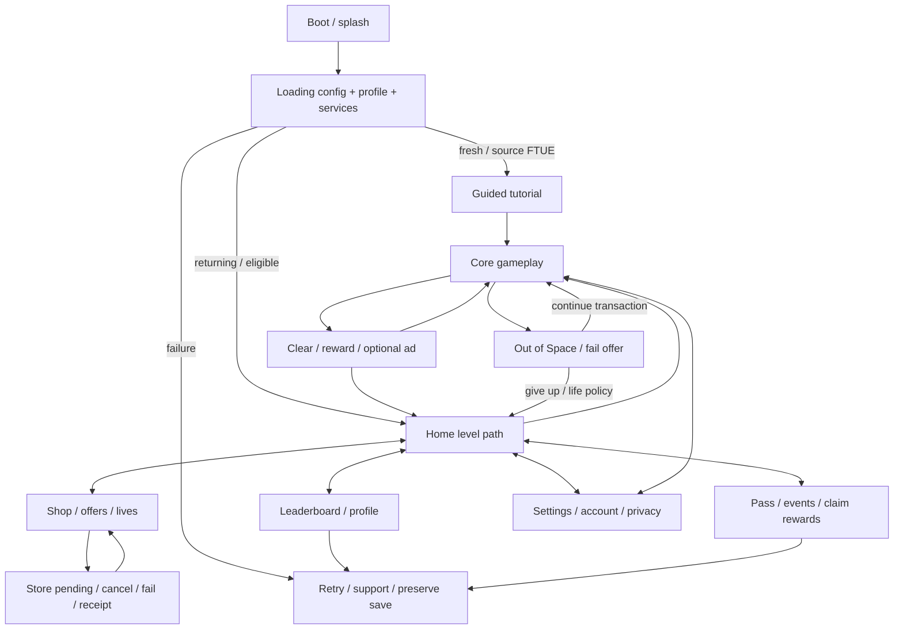

# Pixel Flow — brief clone toàn game theo bản0.36.3

Chỉ dẫn owner mới nhất: khi yêu cầu clone hoàn thiện y hệt, phải chuẩn bị đầu vào đầy đủ trước khi triển khai, tìm gameplay/chức năng trên mạng và có screenshot đối chiếu; sau khi trích asset phải có JSON link đến từng asset. Áp dụng cho Pixel Flow trước rồi mới đưa quy trình vào toolkit. Không build player.

## Định nghĩa đích và trạng thái thật

Đích là toàn trải nghiệm Pixel Flow, gồm bootstrap/loading, onboarding, Home/menu, core puzzle, vật phẩm, thắng/thua/continue, shop/offer, lives, rank/season, pass/event, settings/profile/privacy/save và lỗi/khôi phục. Không tự đổi thành “core loop offline”, vài màn đại diện hay UI agent thiết kế. Một checkpoint có thể chạy được nhưng không phải bản clone toàn game đã hoàn thiện.

Target nguồn là XAPK0.36.3, versionCode410, package `com.loomgames.pixelflow`, hash `ad7b8a8f7659ec86a583976e466458b69fd58f08f2667f6f17925fa570e9bad2`. Data/export giữ ngoài repo tại `D:/Downloads/PixelFlow_0.36.3_extracted`. Không thay đổi nguồn. Unity project clone vẫn `D:/Game/PixelFlowClone`, Editor6000.4.12f1; không nâng package/engine trong công việc brief này.

**Chưa đạt exact clone.** Source cũ đã chạy được contract offline,91 test luật/data/save và6 fixture UI. Những test đó không chứng minh menu/shop/rank/loading giống game gốc. Các kết luận “full offline” trước đây được giữ như checkpoint lịch sử; không dùng làm ngoại lệ để bỏ chức năng owner vừa yêu cầu.

## Bộ đầu vào để triển khai

| Tài liệu | Dùng vào việc gì |
|---|---|
| [screen-contracts.json](screen-contracts.json) |65 bề mặt/luồng; entry, hành động, trạng thái lỗi, nguồn, asset và sai lệch hiện tại theo ID |
| [review.html](review.html) | Duyệt từng luồng, tìm theo từ khóa, mở ảnh gốc/clone và asset; ảnh thiếu được ghi rõ |
| [Research/sources.json](Research/sources.json) | Trang chính thức, store, video và phân tích; URL/loại nguồn/version/receipt |
| [visual-evidence.json](visual-evidence.json) | Ảnh đã xem, ảnh nào dùng được/loại khỏi runtime evidence; không lấy hình game khác từ related articles |
| [Research/capture-receipts.json](Research/capture-receipts.json) | Screenshot trang web và ảnh xuất bản tải về, hash/URL; webpage screenshot không đồng nghĩa screenshot trong game |
| [source-ui-structure.json](source-ui-structure.json) |23 prefab/scene/config nguồn:1.314 node,352 GUID tham chiếu; geometry/font/sprite và node names đọc từ YAML |
| [../AssetCatalog/manifest.json](../AssetCatalog/manifest.json) | Điểm vào catalog đầy đủ;24.588 file export và77.970 source object |
| [screen-asset-links.json](screen-asset-links.json) | Liên kết tập asset ứng viên theo65 luồng; catalog toàn bộ vẫn là nguồn chuẩn |
| [validation.json](validation.json) | Kiểm tra link/hash/ID và báo các gap fidelity; pass cấu trúc không phải pass clone |

Các con số này đếm hiện vật và phạm vi đã khảo sát; không phải điểm fidelity hay bằng chứng mọi chức năng đã hoạt động.

## Nghiên cứu và thứ tự tin cậy

1. Metadata và serialized asset của đúng0.36.3 xác nhận loại tài nguyên, node và data tồn tại. Prefab/field không khẳng định callback, lịch server hay ngưỡng unlock đang active. Dummy AssetRipper C# không được dùng làm logic khôi phục.
2. Gameplay công khai có metadata tác giả/ngày/độ dài; kiểm tra hình cụ thể, ghi state/aspect và timestamp gần đúng. Video hiện có không khẳng định đúng phiên bản0.36.3.
3. [Loom Help Center](https://loomgames.helpshift.com/hc/en/3-pixel-flow/) xác nhận mô tả chức năng hiện hành. Đã khảo sát toàn bộ6 nhóm và34 FAQ được liên kết tại thời điểm nghiên cứu. Không lấy lịch/feature hiện tại áp thẳng vào bản XAPK cũ.
4. [Heroic Labs](https://heroiclabs.com/blog/pixel-flow-highlight-announcement/) là nguồn bên cung cấp backend, có hình gameplay và Arena/Fire Quest; hỗ trợ việc xác định các hệ thống account/cloud/event có thật, không cung cấp implementation server của Loom.
5. [Phân tích shop](https://www.linkedin.com/pulse/whats-wrong-pixel-flows-game-shop-michael-khripin-m0xpf), [first-hour](https://www.linkedin.com/pulse/first-hour-deconstruction-pixel-flow-loom-games-sungsu-kim-mgz6f/) và [montage UI](https://www.linkedin.com/posts/jakubremiar_pixel-flow-by-loom-games-is-already-doing-activity-7417592653606764544-k1FZ) có screenshot được xem trực tiếp. Đây là quan sát bên thứ ba theo phiên bản/state của họ. Mốc level/ngày có chỗ không nhất quán nên cần đối chiếu config và native0.36.3 trước khi dùng như số đo chuẩn.
6. Store images là marketing; gallery cơ chế là minh họa; site walkthrough chỉ dùng để tìm video/ảnh và được kiểm tra lại. Bỏ qua mô tả website lẫn game nối đường/nonogram hoặc ảnh related article của game khác.

Không khẳng định đã “tìm hết Internet”. Điều kiện bao phủ là mỗi màn/chức năng trong graph có nguồn, trạng thái ảnh và gap cụ thể. Bổ sung khi phát hiện surface mới; không chốt đầy đủ bằng một số lượng trang tùy ý.

## Luồng tổng thể và gating cần giữ

Graph là hợp đồng kiểm kê; routing FTUE/Home chính xác theo0.36.3 phải xác nhận. Các entry từ coin-plus, heart-plus, Settings trong level, Back/X và claim pending là một phần luồng, không chỉ nút ở Home.

## Bootstrap, loading và onboarding — SYS01–05, FTUE01–04

- Dùng asset splash/logo/background/bar nguồn nếu binding còn hợp lệ. Native Boot scene đã có `Splash Screen`, `Splash Loading Bar`, `Loading Support Button`, `Load Home Or Level`. Source hiện tại chưa tái hiện loading này.
- Loading phải thể hiện stage/progress thật, khóa input khi chưa sẵn sàng và có retry/support theo source; không vẽ100% giả rồi treo. Profile/config lỗi không được reset wallet hoặc lịch sử để cho game chạy.
- Save mới và save đã qua onboarding có entry khác nhau nếu nguồn chứng minh. First-hour/video cho thấy hướng dẫn chạm được lồng ngay trên board; bốn trang chữ của clone không phải UI gốc.
- Booster/feature intro phải mở theo ngưỡng nguồn, với icon và spotlight tương ứng. Mốc thường được report như Tray7/Hand12/Shuffle15/Super18 và Arena sau31 chỉ là ứng viên cần kiểm config/version; không hardcode như đã được đo đúng0.36.3.
- Phải kiểm interrupted tutorial, wrong tap, skip/close nếu có, scene reload và persisted seen/unlocked. Giữ flow nhỏ để dễ test nhưng không thu hẹp số chức năng cần hoàn thiện.

## Home/menu/navigation — HOME01–05

Hình nguồn cho thấy Home là bản đồ level dọc, node Hard/Very Hard, nút Play, header heart/coin/settings, dock sự kiện/offer và tab dưới. Clone hiện là logo/Hero với grid nút, cần thay bằng composition gốc thay vì thêm một nút “Rank” vào thiết kế cũ.

Cần các state: mới unlock Home, tiến độ giữa campaign, level hard/very hard, zero/max/unlimited lives, reward đang resolve, sự kiện locked/active/claimable/expired, tab khóa/mở và endgame league khi hết content. Scroll map và tab phải giữ vị trí hợp lý khi quay lại từ Shop/Rank/settings.

Current campaign selector20-button hữu ích làm công cụ QA nhưng chưa được chứng minh là chức năng người chơi của game gốc. Không giữ như main UX nếu native chỉ có next/current level path. Bản đồ và số node hiển thị cần dùng đúng source art/layout và tiến độ.

## Gameplay và toàn bộ cơ chế — PLAY01–11

Nguồn data có2.600 màn chính,517 definition ở funnel phụ. Main campaign không được bỏ field để cho parser nhận level. Đã có typed model cho12 nhóm shooter và24 board kinds, nhưng nhiều event semantics hiện là inferred. Cần test native cùng schema/state trước khi ghi parity.

| Nhóm | Nội dung cần đối chiếu |
|---|---|
| Pixel/Hard/Hidden | Health/spans dùng chung; reveal xảy ra khi nào; mặt voxel/material/light và âm hit |
| Surprise/Connected/Chains | Khi lộ màu/đạn; group acceptance và entrance spacing; chain tháo hay giữ lúc nào |
| Locks/Keys/Pipes | Key bị che và giải phóng; lock mapping; payload/render và thứ tự pig pipe |
| Hammer/Wood/Ice | Vật thể hỗ trợ dùng animation gì; đập theo reach front hay tap; ice pig giảm khi hit hay pig depletion |
| Totem/Mallet/Music | Trigger đếm, màu lớp kế tiếp, số lượt hỗ trợ và thứ tự rời queue |
| Gate/Pipe/Snake/MultiSnake | Hướng/độ thu, pixel được spawn hay layer target, lane/occlusion động |
| Egg/Pumpkin/Beans/Doll | Hình stage/layer, bonus fragments, shared health, target transitions |
| Wall/ColorDoor/Biscuit/Curtain/Split | Footprint, rule unblock và điều kiện màu/lượt; không tự gộp mọi thứ thành giảm counter |
| UFO/Cage/ColoredCage | Pig đi vào seat/thoát cage, ammo identity, active layer và phát sinh queue |
| Crossbow/Accordion/Mixer | Hướng/bắn/thu/phối màu thực tế; current Crossbow chỉ là HP target, chưa recovered native behavior |
| Astronaut/Spaceship/SlotCage/BeltDoor | Cửa tương tác theo pig hay pixel; mapping màu và slot, return early và capacity |

Reference gallery hiện nói Frozen Pig vỡ khi các pig khác hết đạn, trong khi code clone đang giảm ice theo pixel hit. Đây là **mâu thuẫn cần kiểm chứng**, không sửa rule theo một fan caption rồi coi là đã đúng. Tương tự gate/pipe được mô tả thu/spawn, không có nghĩa chỉ là board goal nhiều layer. Đặt bằng chứng cùng cấp đúng chỗ.

Belt có bo góc mềm và gear/settings là entry chính trong hình nguồn. Camera, tỷ lệ board, khoảng waiting/queue, pig facing, text ammo, entrance và firing cadence cần đo từ runtime; current procedural đường vuông khác rõ. Mọi phép so screenshot ghi aspect, level layout/state và số pig active; khác board vẫn dùng được cho layout chung nhưng không cho hit-order parity.

Tray/Hand/Shuffle/Super phải giữ nguyên interaction nguồn, locked/unlocked/no-stock/target/cancel/effect/claim/error. Giá/capacity/max và object exclusions phải có provenance. Unicorn tài liệu hiện hành cần tách với0.36.3; không tự thêm mới vì web mới hơn nếu target không có, cũng không bỏ feature được xác nhận trong target.

## Thắng/thua/pause/continue — PAUSE01–02, WIN01–02, LOSE01–03

Win không chỉ là status model: source reward/celebration/Continue, coin fly, optional rewarded multiplier, pass/event resolve và chuyển level/Home đều thuộc luồng. Chống duplicate callback, suspend/relaunch giữa reward và grant thất bại.

Fail screenshot có `OUT OF SPACE!`, preview board, coin continue, fail offer, close và Hold to See Game. Price900 trong screenshot chỉ là state/version đó. Current giá100 + thêm waiting slot/clear blocker là contract tự thiết kế, cần thay sau khi xác minh source continue action, không coi là equivalent.

Settings nguồn chứa Restart và Give Up nên cần life-warning/confirm/cancel đúng nơi. Free Retry và Home snapshot hiện tại chưa chứng minh đúng native; không xóa dữ liệu đang chơi khi chỉ đóng popup. Cần full waiting, return-in-flight, đang mở settings, active event, unlimited-heart và không đủ coin.

## Shop/monetization/lives — SHOP01–07, LIFE01–02

- Source shop là feed dọc, header/roof xanh, Gold Packs6 thẻ3×2, No Ads/No Ads Bundle và bundle các tier màu. Assortment thay đổi theo progression; screenshot chứng minh nhiều state. Current shop đổi coin lấy4 booster là sai thiết kế.
- Chọn sprite/prefab đã trích: `Shop Page Variant`, `Shop Gold View`, `Shop No Ads View`, các bundle variants và icon item/coin/heart. Không dựng hình chữ nhật thay art nguồn khi đã có art dùng được.
- Amount/giá trong hình chỉ là reference locale/time. Giá tiền phải đến store catalog/adapter; pending/cancel/failure/restore/duplicate receipt cần thật. Không nhấn “mua” là cộng đồ, không kết nối backend/billing của Loom bằng thông tin trích từ package.
- Có thể làm đủ client UI/domain/adapter contract mà chưa bật dịch vụ production. Nhưng nếu provider/credential/entitlement verification chưa có thì trạng thái là **service-unverified**, không gọi full online parity. Không tự bỏ shop/rank khỏi brief vì thiếu backend.
- Heart HUD có count/max/regeneration countdown, unlimited duration và refill options. Source có heart settings assets; phải resolve static values/remote override. Kiểm UTC/relaunch/offline, cap, expiry trong level và loss/continue/retry liên hệ lives.
- Offerwall/external rewards phải có state open/return/pending/support/error nếu0.36.3 xác nhận; không lắp SDK/đăng ký dịch vụ/phát sinh chi phí chỉ để che gap trong UI.

## Rank/profile/pass/events — RANK01–03, TEAM01, PASS01–03, EVT01–08

Rank là luồng đầy đủ: source prefab có top3 podium, danh sách avatar/name/score/prize, self jump, Loading/LoadingError/Retry. Cần monthly season/master/history/claim ở nơi0.36.3 có data. Không tạo bot list giả và gọi là leaderboard online.

Tài liệu chính thức hiện hành nói monthly top1000 và score theo clear; phải tách per-version rules. Teams xuất hiện trong help mới nhưng chưa có bằng chứng mạnh trong asset0.36.3; giữ requirement điều tra target-version, không đoán có hay loại luôn.

Pass cần track free/premium, progress/locked/earned/claimed, Golden Ticket benefits/entitlement và bonus/end/claim window. Source có nhiều prefab phần này; hiện clone chưa nối. Tài liệu và ảnh Arena/Fire Quest chứng minh event UI ngoài puzzle là phạm vi thật, không phải cosmetic tùy chọn.

Event matrix gồm Fire Quest, Pixel Arena, Pixel Race, Cosmic Journey, Temple Mission, Medal Rush, Fairy Forest. Đối với từng event: target-version presence, unlock, lịch/múi giờ, entry/info, progress/scoring/streak, stage/leaderboard, win/loss/reset, reward claim, expired/offline/retry. Các event mới chỉ có trong web được đánh dấu version-unconfirmed, không auto-import hết vào0.36.3.

Không đồng nhất daily clone hiện tại với một daily gốc. Shop analysis không thấy daily-gift section trong version được phân tích, trong khi help nói có daily reward nói chung; vị trí, thời gian và loại claim phải điều tra, tránh tự đặt nút Daily rồi gọi faithful.

## Settings/account/privacy/localization — SET01–04, SAVE01–02, SYS06–07

Đọc trực tiếp `Settings View Variant.prefab` cho thấy: Music và Sound là slider riêng; Haptic, Notification và Smooth Motion là toggle; Privacy Settings, Send Feedback, Restore Purchases, Save Your Progress, Restart, Give Up, Instagram, Delete Account, Version và Nakama User ID. Current page với sound/music/haptic switch + volume± thiếu cả layout lẫn luồng.

Cần username/avatar/provider/guest/cloud save/conflict/recovery state thật khi source có. Apple/Google login và backend của clone phải dùng hạ tầng riêng được cấu hình, không dùng token/credential từ artifact. Test cancel/deny/offline và chưa có provider; client không được báo sync thành công nếu chỉ ghi local.

Profile local/save migrations hiện đã có test hữu ích; phải giữ dữ liệu người dùng khi thay UI. Bổ sung policy source cho mid-run resume, give up, hearts/events/transactions. Delete account phải có confirm rõ và source provider path; không dùng xóa folder save như giả lập một thao tác tài khoản đã hoàn tất.

Font/TMP, giá dài/name dài, localization keys, aspect/safe area, Back/X/modal raycast và app background/kill/relaunch là acceptance. Các bản offscreen synthetic input hiện tại không thay cho native touch/lifecycle hoặc Game View quan sát thật. Âm thanh phải nghe/mix đúng state, không suy từ file WAV/OGG có mặt.

## Asset đủ thì hoàn thiện ra sao

Sau extraction, bắt buộc có JSON từng file: ID, path/URI, type, GUID nếu có, source object/pathID, bytes, hash receipt hoặc lý do không đọc, role candidates, source/import mapping và availability. [AssetCatalog](../AssetCatalog/manifest.json) đã có; raw retained/failed object vẫn được giữ trong objects.json, không biến thành asset thành công.

Đối với mỗi surface, resolve các candidate thành binding có chủ đích: source assetID → output path/meta GUID → prefab/scene/component/UI role → import material/font/slice/scale → screenshot trạng thái thực tế. Chỉ presence/name chưa đủ kết luận “đã đủ”. Selected UI có10 tham chiếu đến2 GUID built-in Unity, không phải10 asset xuất bị mất; chúng cần engine resolve khi import. Không regenerate GUID hoặc đổi YAML mù.

Nếu cùng role đã có asset gốc sử dụng được thì ưu tiên nó. Procedural/AI chỉ là gap route có lý do được ghi, không được dùng để né nối prefab/sprite có sẵn. Screenshot của màn hình không được dùng làm ảnh nền giả các button/scroll/animation.

Khi tất cả asset cho một screen đã xác nhận đủ và behavior có reference, thực hiện trọn entry → action → effect → exit/persistence/error, chụp và so lại. Không dừng ở “đã import” hoặc “có nút”. Có asset đầy đủ không tự khôi phục native logic hay server; các phần thiếu phải được đưa thành việc cụ thể.

## Tooling, Unity và cách thông báo

Lượt chuẩn bị này không cần bật Unity: đọc metadata, chụp browser và dùng capture clone đã có. Không có Unity MCP tool được expose trong phiên hiện tại. Không coi có package `com.coplaydev.unity-mcp` là đã có kết nối.

Trước khi sửa/đối chiếu scene UI thật, nếu cần Editor tương tác/MCP, báo người dùng: lý do cần Game View (ví dụ slider/modal/animation/asset binding), project/scene, cần mở Unity hay reconnect, và việc cụ thể sẽ làm. Đây là thông báo để phối hợp, không hỏi lại quyền sửa đã được owner cho. Không âm thầm thay Game View bằng batch preview và gọi tương đương. Nếu MCP chưa dùng được, ghi limitation và dùng fallback cho phần nó thật sự chứng minh được; vẫn giữ gate Game View chưa đạt.

Không chạy player build. Batch compile/tests có thể tiếp tục khi code thay đổi; chạy tuần tự, biết đúng process/instance, không phá Editor người dùng đang mở.

## Trình tự triển khai sau brief

1. **Chốt evidence theo surface:** bổ sung screenshot native0.36.3 cho settings, monthly rank/pass, event versions, fail/retry/lives; dùng ảnh đã có để phát hiện sai lệch ngay. Không coi những gap đó là việc “không trong scope”.
2. **Khôi phục UI shell bằng asset:** loading, Home level path/header/tab và settings modal; kiểm tất cả source controls và states. Giữ source code/game state đang chạy được.
3. **Shop/lives/profile/rank/pass/event:** client/data/services tách owner; từng luồng đủ loading/error/empty/pending/cancel/success; dùng provider thực khi đã có cấu hình. Đánh dấu contract-only nếu chưa có external service.
4. **Gameplay parity:** lần lượt đối chiếu source1/8/14 và representative mỗi loại; sửa inferred rule dựa evidence, không chỉ tăng số level parser nhận. Re-run regression đã có sau mỗi thay đổi.
5. **Visual/feel:** cùng aspect/state/level; source/clone screenshot pair, annotate mismatch, sửa artifact và chụp lại; xem transitions ở tốc độ thường, nghe audio.
6. **Toàn graph:** fresh/existing save, unlock, shop/restore, rank/services, win/loss/continue, reward, app pause/reload và locale. Chỉ đánh dấu full clone khi các requirement đều có bằng chứng phù hợp hoặc loại rõ theo lựa chọn owner.

Không cần xin phép để chuẩn bị brief, liệt kê/cắt ảnh nghiên cứu, lập mapping hoặc sửa source trong phạm vi đã yêu cầu. Chỉ cần thông tin/khả năng bên ngoài mà ta chưa có (runtime0.36.3/provider/device) mới được nêu là dependency thực; không hứa đã làm xong bằng màn hình giả.

## Gate và bàn giao

- `research-consistent`: source/capture/hash/link/ID hợp lệ; đây là kiểm cấu trúc.
- `brief-parity-ready`: mỗi chức năng target có hành vi/trạng thái, version, visual source và asset decision đủ để triển khai; hiện còn gap chụp source0.36.3 ở một số màn.
- `implemented`: trọn luồng/UI/asset/service; không chỉ button/placeholder.
- `functional-verified`: reproduction từ entry và tất cả nhánh thích hợp, test không bypass chính đường nó tuyên bố chứng minh.
- `visually-compared`: mở ảnh gốc/clone đúng state; sai lệch có ID/fix/evidence mới.
- `feel/device/service-verified`: evidence riêng; không suy từ rule test, marketing image hay mock.
- `full-clone-complete`: toàn graph chức năng đã xác nhận, target version đúng, không còn sai lệch bắt buộc hoặc phần loại ngầm. Hiện **false**.

Mỗi task tiếp theo đọc brief này,65 contracts, CURRENT_STATE và review. Không thêm feature theo phỏng đoán và không tuyên bố “xong full gameplay/UI y hệt” từ số test xanh.
